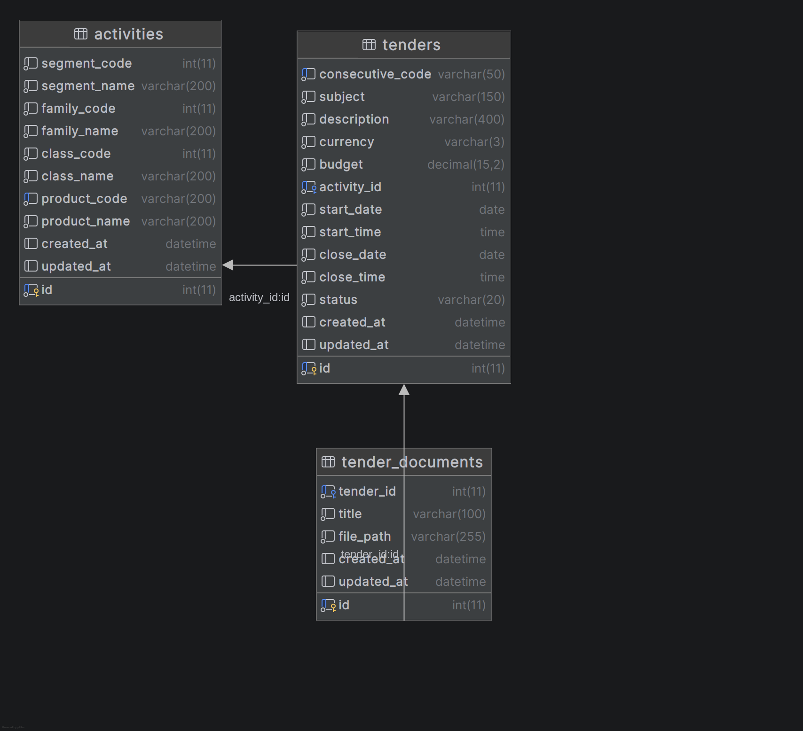

# Tenders Backend

API de licitaciones construida en PHP puro, con `illuminate/database`, `illuminate/events` e `illuminate/pagination` como componentes, Eloquent como ORM y `vlucas/phpdotenv` para la configuración. Sigue una arquitectura MVC sin frameworks ni micro-frameworks.

Todas las respuestas de la API (JSON y mensajes de error) se devuelven en inglés.

## Requisitos

- PHP 8.3 o superior (probado en PHP 8.5)
- Composer 2.x
- MariaDB o MySQL con la extensión `pdo_mysql`

## Instalación

```bash
git clone https://github.com/fer-gc05/tenders-backend.git
cd tenders-backend
composer install
cp .env.example .env
```

Edita `.env` con las credenciales de tu base de datos. Los valores por defecto apuntan a MariaDB en `127.0.0.1:3306`, base `tenders` y usuario `root`; ajústalos a tu instalación.

## Base de datos

El esquema y el diagrama se conservan en `docs/db/`:

| Archivo | Contenido |
| --- | --- |
| [`docs/db/schema.sql`](docs/db/schema.sql) | Script de construcción de la base de datos |
| [`docs/db/tenders.png`](docs/db/tenders.png) | Diagrama entidad-relación |



Para crear la base de datos y sus tablas, carga el script:

```bash
mariadb -u root -p < docs/db/schema.sql
```

El script crea la base de datos con `create database if not exists`, pero las tablas se crean sin esa salvaguarda: al reejecutarlo sobre una base ya poblada, MySQL/MariaDB responderá `Table 'activities' already exists`. Para reconstruir el esquema desde cero, elimina primero la base de datos:

```bash
mariadb -u root -p -e "DROP DATABASE IF EXISTS tenders;"
mariadb -u root -p < docs/db/schema.sql
```

### Tablas

| Tabla | Contenido |
| --- | --- |
| `activities` | Catálogo de productos y servicios que se pueden licitar, clasificados por segmento, familia y clase. |
| `tenders` | Licitaciones: código consecutivo, objeto, presupuesto, moneda, fechas de apertura y cierre, estado y actividad asociada. |
| `tender_documents` | Documentos adjuntos a cada licitación (título y ruta del archivo en el servidor). |

### Relaciones

- `tenders.activity_id` → `activities.id`
- `tender_documents.tender_id` → `tenders.id`

Las tres tablas registran `created_at` y `updated_at` de forma automática (`datetime` con `current_timestamp`).

## Ejecución

### Servidor de desarrollo

```bash
composer dev
```

Levanta el servidor embebido de PHP en `http://localhost:8000` con `public/router.php` como router, de modo que todas las rutas de la API (y no solo `/index.php`) llegan al front controller.

```bash
curl http://localhost:8000/api/v1/status
# {"app":"tenders_backend","status":"ok"}
```

## Endpoints

| Método | Ruta | Descripción | Respuesta |
| --- | --- | --- | --- |
| `GET` | `/api/v1/status` | Estado del servicio. | `200` `{"app":"tenders_backend","status":"ok"}` |
| `POST` | `/api/v1/tenders` | Crea una licitación; acepta JSON o `multipart/form-data` con documentos. | `201` con la licitación creada |
| `GET` | `/api/v1/tenders` | Lista las licitaciones con filtros y paginación. | `200` `{"data":[...],"meta":{...}}` |
| `GET` | `/api/v1/tenders/{id}` | Detalle de una licitación con su actividad y sus documentos. | `200` `{"data":{...}}` |
| `POST` | `/api/v1/tenders/{id}` | Actualiza una licitación; acepta `multipart/form-data` para añadir documentos. | `200` con la licitación actualizada |
| `PUT` | `/api/v1/tenders/{id}` | Actualiza una licitación con JSON (no admite archivos). | `200` con la licitación actualizada |
| `GET` | `/api/v1/tenders/{id}/documents/{documentId}` | Descarga el archivo de un documento. | `200` con el binario y `Content-Disposition` |

Las rutas inexistentes responden `404` y las peticiones con un método no permitido responden `405`, siempre en JSON. El `405` incluye el header `Allow` con los métodos registrados para la ruta (por ejemplo, `Allow: GET`), como exige el estándar HTTP.

### Parámetros del listado

| Parámetro | Descripción |
| --- | --- |
| `status` | Filtra por estado (`draft`, `published`, `closed`). |
| `activity_id` | Filtra por el identificador de la actividad. |
| `search` | Busca coincidencias en el objeto de la licitación. |
| `page` | Página actual (por defecto `1`). |
| `per_page` | Resultados por página (por defecto `15`, máximo `50`). |

La respuesta del listado envuelve los resultados en `data` y la paginación en `meta` (`total`, `current_page`, `per_page`, `last_page`).

### Código consecutivo

El código consecutivo lo genera el servidor con el formato `PO-XXXX-AA`: cuatro dígitos con el consecutivo del año y los dos últimos del año (`PO-0001-26`). El consecutivo se reinicia cada año y se deriva del máximo ya registrado en `tenders.consecutive_code`, así que no hace falta una tabla de secuencias ni se altera el esquema de la base de datos. Si dos peticiones simultáneas obtienen el mismo código, la que pierda la carrera reintenta con el siguiente valor.

### Documentos

Los documentos se suben en la creación y en la edición de la licitación mediante `multipart/form-data`, en el campo `documents[]`:

```bash
curl -X POST http://localhost:8000/api/v1/tenders \
  -F "subject=Pliego de la licitación" \
  -F "description=Descripción de la licitación" \
  -F "currency=COP" \
  -F "budget=15000000.00" \
  -F "activity_id=1" \
  -F "start_date=2026-11-01" \
  -F "start_time=09:00" \
  -F "close_date=2026-12-01" \
  -F "close_time=17:00" \
  -F "documents[]=@pliego.pdf;type=application/pdf"
```

Solo se aceptan PDF y ZIP de hasta 10 MB, y el tipo se comprueba sobre el contenido real del archivo, nunca sobre el que declara el cliente. Al editar, la licitación debe conservar al menos un documento: los que ya tiene más los nuevos que se suben. Los archivos se guardan en `storage/uploads/` con un nombre aleatorio y solo se sirven a través del endpoint de descarga.

Para que la aplicación acepte archivos de hasta 10 MB, el servidor debe permitirlo:

| Configuración | Valor mínimo |
| --- | --- |
| `upload_max_filesize` (php.ini) | `10M` |
| `post_max_size` (php.ini) | `20M` |
| `client_max_body_size` (nginx) | `20m` |

## Estructura

```
app/
├── Config/
│   └── Database.php          Inicialización de la conexión y Eloquent
├── Controllers/
│   ├── TenderController.php  Creación, edición, listado y detalle de licitaciones
│   └── DocumentController.php Descarga de los documentos adjuntos
├── Http/
│   ├── Controller.php        Controlador base
│   ├── FormRequest.php       Solicitud con validación declarativa
│   ├── Request.php           Solicitud HTTP
│   ├── Response.php          Respuesta HTTP
│   ├── Router.php            Enrutador
│   └── Requests/
│       └── Tenders/          Validaciones de creación y actualización de licitaciones
├── Models/
│   ├── Activity.php          Catálogo de actividades
│   ├── Tender.php            Licitaciones y código consecutivo
│   └── TenderDocument.php    Documentos adjuntos y manejo de archivos
├── Support/
│   ├── ErrorHandler.php      Manejo global de errores y excepciones
│   ├── ValidationException.php
│   └── Validator.php         Motor de reglas de validación
└── Views/
    ├── TenderView.php        Representación JSON de las licitaciones
    └── DocumentView.php      Representación JSON de los documentos
config/
└── Database.php              Configuración de la base de datos
docs/
└── db/
    ├── schema.sql            Construcción de la base de datos
    └── tenders.png           Diagrama entidad-relación
routes/
└── api.php                   Definición de rutas de la API
storage/
└── uploads/                  Archivos subidos por las licitaciones (no se versiona)
public/
├── index.php                 Punto de entrada (bootstrap)
└── router.php                Router del servidor embebido (desarrollo)
```

El flujo MVC es `Request → Router → Controller → Model → View → Response`. Los controladores devuelven la respuesta ya serializada y las vistas se encargan de dar forma al JSON de cada recurso.

Las clases de `app/Http` y `app/Support` implementan la capa HTTP: el enrutador soporta rutas con parámetros (`{id}`), closures o `[Controller::class, 'metodo']`, y responde 404/405 en JSON.

### Convención de documentación

Las clases nuevas o modificadas llevan un encabezado que registra autoría, versión, fecha de creación, fecha de última actualización y espacio de nombres. Cada modificación añade además su entrada en el historial `@change`:

```php
/**
 * Realiza la validación de la solicitud de autenticación mTLS y parámetros de red.
 *
 * @author    Fernando Luis Gil Correa
 * @version   1.0.1
 * @since     2026-10-24
 * @updated   2026-10-25
 * @package   App\Http\Requests
 *
 * @change    1.0.1 - 2026-10-25 - Fernando Luis Gil Correa - Ajuste de reglas de validación.
 */
```

| Etiqueta | Regla |
| --- | --- |
| `@author` | Autoría del código. No cambia. |
| `@version` | Versión semántica de la clase (`MAJOR.MINOR.PATCH`). Se incrementa en cada modificación. |
| `@since` | Fecha real de creación del archivo. No cambia. |
| `@updated` | Fecha de la última modificación. En la creación coincide con `@since`. |
| `@package` | Espacio de nombres al que pertenece la clase. |
| `@change` | Historial de cambios, con el formato `versión - fecha - autor - descripción`. Una línea por versión, la más reciente primero. |

La versión sigue el criterio habitual: *patch* para ajustes internos, *minor* cuando se incorpora comportamiento nuevo y *major* cuando el cambio rompe la compatibilidad de la clase. Las clases que ya existían antes de esta convención conservan su encabezado original (`@author`, `@version`, `@since`, `@package`) hasta que se modifiquen.

### Manejo de errores

`App\Support\ErrorHandler` registra los manejadores global de PHP y convierte cualquier excepción en una respuesta JSON:

| Situación | Código | Cuerpo |
| --- | --- | --- |
| Error de validación | `422` | `{"error":"Validation error.","errors":{...}}` |
| Excepción no controlada | `500` | `{"error":"Internal server error."}` |

Con `APP_ENV=local` la respuesta `500` incluye el mensaje original, el archivo y la traza, para facilitar el diagnóstico. Los avisos (`E_NOTICE`) y las deprecaciones (`E_DEPRECATED`) no interrumpen la petición: se escriben en el log del servicio (`journalctl -u php-fpm`); solo las advertencias y los errores reales se convierten en `500`.

## Validación

La validación se define en clases que extienden `App\Http\FormRequest`. El Router las detecta por el type-hint del controlador y valida **antes** de ejecutarlo; si falla, responde `422` con los errores en inglés.

Cada solicitud vive en `app/Http/Requests/` y sus reglas se corresponden con las columnas de la tabla que recibe. Las solicitudes de licitación comparten las reglas comunes en `app/Http/Requests/Tenders/TenderRequest.php` y las completan en `StoreTenderRequest.php` y `UpdateTenderRequest.php`:

`app/Http/Requests/Tenders/TenderRequest.php`

```php
<?php

namespace App\Http\Requests\Tenders;

use App\Http\FormRequest;

abstract class TenderRequest extends FormRequest
{
    public function rules(): array
    {
        return [
            'subject' => 'required|string|max:150',
            'description' => 'required|string|max:400',
            'currency' => 'required|string|max:3|in:COP,USD,EUR',
            'budget' => 'required|numeric|min:0|max:9999999999999.99',
            'activity_id' => 'required|integer',
            'start_date' => 'required|date',
            'start_time' => 'required|time',
            'close_date' => 'required|date',
            'close_time' => 'required|time',
            'status' => 'nullable|string|max:20|in:draft,published,closed',
        ];
    }
}
```

`app/Controllers/TenderController.php`

```php
<?php

namespace App\Controllers;

use App\Http\Controller;
use App\Http\Requests\Tenders\StoreTenderRequest;
use App\Http\Response;

class TenderController extends Controller
{
    public function store(StoreTenderRequest $request): Response
    {
        $data = $request->validated();  // solo los campos de rules()
        // ...
    }
}
```

El controlador recibe la solicitud ya validada: si alguna regla falla, el Router interrumpe el flujo y responde `422` sin llegar a ejecutar el método.

Las reglas se ajustan al esquema de `tenders`: `max` respeta la longitud de la columna, `in` acota los valores permitidos y `nullable` acepta que el campo no llegue, de modo que la base de datos aplique su valor por defecto (`draft` en el caso de `status`). `min` y `max` interpretan el valor según su tipo: un array se compara por la cantidad de elementos, un valor numérico (incluida una cadena como `"15000000.00"`) por su valor y cualquier otra cadena por su longitud; así, el presupuesto se acota con `numeric|min:0` y los textos con `max:<longitud de la columna>`. La regla `date` exige el formato ISO `YYYY-MM-DD` (rechaza `"next monday"` o el 31 de febrero) y `time` exige `HH:MM` o `HH:MM:SS` entre `00:00:00` y `23:59:59`.

Respuesta de error:

```json
{
    "error": "Validation error.",
    "errors": {
        "subject": ["The subject field is required."]
    }
}
```

Reglas disponibles: `required`, `nullable`, `string`, `email`, `integer`, `numeric`, `boolean`, `array`, `min:<n>`, `max:<n>`, `date`, `time`, `in:val1,val2`.

Las validaciones que las reglas no expresan (por ejemplo, que una clave foránea exista, que el cierre sea posterior a la apertura o que los archivos sean válidos) se agregan en el hook `after()` de cada `FormRequest`, que se ejecuta solo si las reglas pasan y devuelve un mapa `campo => mensajes` para responder `422`:

```php
protected function after(): array
{
    $errors = [];

    if (!Activity::find($this->body('activity_id'))) {
        $errors['activity_id'] = ['The selected activity is invalid.'];
    }

    if (!$this->closureIsAfterStart()) {
        $errors['close_date'] = ['The close date and time must be after the start date and time.'];
    }

    return $errors;
}
```

La actualización de licitaciones añade además que la licitación conserve al menos un documento: los que ya tiene más los nuevos que se suben.

## Variables de entorno

| Variable | Descripción | Valor por defecto |
| --- | --- | --- |
| `APP_NAME` | Nombre de la aplicación | `tenders_backend` |
| `APP_ENV` | Entorno de ejecución. En `local`, los errores 500 incluyen mensaje, archivo y traza | `local` |
| `APP_TIMEZONE` | Zona horaria de PHP. Debe coincidir con la de la base de datos | `America/Bogota` |
| `DB_CONNECTION` | Driver de base de datos | `mariadb` |
| `DB_HOST` | Host de la base de datos | `127.0.0.1` |
| `DB_PORT` | Puerto de la base de datos | `3306` |
| `DB_DATABASE` | Nombre de la base de datos | `tenders` |
| `DB_USERNAME` | Usuario de la base de datos | `root` |
| `DB_PASSWORD` | Contraseña de la base de datos | vacío |
